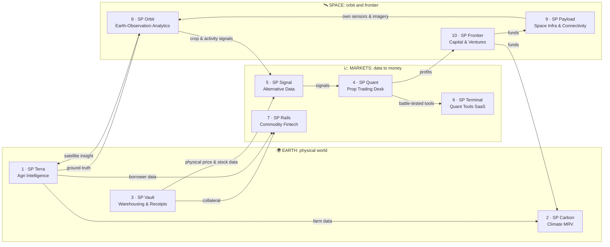

# From Earth → to Markets → to Space

**A 10-company group blueprint.** Each company feeds the next. What happens on the ground becomes data. Data becomes money in the markets. Market profits pay for going to orbit. What we see from orbit sharpens what we know on the ground.

> Working names use the **SP** prefix from your existing repos (SP-Dhan-ORB-Bot, SP_Intraday_Scalping_BOT). Swap in your final brand, and run trademark and MCA name checks before registering.

---

## 1. The core thesis: one flywheel, not 10 separate bets

**Three advantages the group builds up over time:**

1. **Proprietary data.** Farm ground truth (1), warehouse stock and prices (3), satellite analytics (8) and crypto/F&O flow data (5). Competitors can buy satellite images, but they can't buy calibrated ground truth.
2. **Capital from the markets.** The trading desk (4) funds the slow, capital-heavy Earth and Space bets, so you give up less equity early.
3. **Distribution into rural India.** Farmer Producer Organisations (FPOs), warehouses and rural lenders carry Terra, Vault and Rails to millions of smallholders.

> **The most important insight:** the *name* runs Earth → Markets → Space, but the **build order must run Markets → Earth → Space**. Markets is where you already have working code, data pipelines and live P&L. Start from your edge.

---

## 2. The 10 at a glance

| # | Company | Pillar | One-liner | Revenue model | Phase |
|---|---------|--------|-----------|---------------|-------|
| 1 | **SP Terra** | 🌍 Earth | Crop intelligence and advisory for smallholder farms, delivered via WhatsApp in local languages | Per-hectare / per-season B2B SaaS | 2 |
| 2 | **SP Carbon** | 🌍 Earth | Low-cost MRV (measure, report, verify) that turns smallholder regenerative farming into carbon credits | MRV fees + share of credit revenue | 3 |
| 3 | **SP Vault** | 🌍→📈 Bridge | Asset-light network of partner warehouses issuing e-NWRs, so farmers store and borrow instead of distress-selling | Storage, collateral-management and sale fees | 2 |
| 4 | **SP Quant** | 📈 Markets | Your existing bots, formalised into a risk-managed prop desk trading **own capital** | Trading P&L | **1 (now)** |
| 5 | **SP Signal** | 📈 Markets | Alternative-data feeds: crypto derivatives flow, then satellite crop and commodity signals | Data subscriptions / API | **1 (now)** |
| 6 | **SP Terminal** | 📈 Markets | Your quant terminal as a product: backtest, build and execute with built-in risk controls, through brokers | SaaS + broker revenue-share / white-label | **1 (now)** |
| 7 | **SP Rails** | 📈 Markets | Embedded agri finance: warehouse-receipt loans, data-underwritten input credit, price hedging for FPOs | Origination / servicing fees via partner NBFCs | 3 |
| 8 | **SP Orbit** | 🛰️ Space | Satellite imagery turned into answers: crop acreage and yield, water stress, industrial and storage activity | Analytics subscriptions / per-report | 2 |
| 9 | **SP Payload** | 🛰️ Space | Satellite IoT for remote farm and warehouse sensors, then a hosted or own hyperspectral payload | Connectivity fees, then data sales | 3 |
| 10 | **SP Frontier** | 🛰️ Space | Group treasury and venture arm that puts market profits into Earth and Space ventures, later a SEBI-registered AIF | Equity upside; later management fee + carry | 3 |

---

## 3. Scorecard: which concepts are strongest

My own scoring, 1–5 (5 = best). "Regulatory ease" of 5 means light regulation.

| # | Company | Founder fit | Speed to revenue | Capital-light | Regulatory ease | Strategic value | **Total /25** |
|---|---------|:-:|:-:|:-:|:-:|:-:|:-:|
| 5 | SP Signal | 5 | 4 | 5 | 4 | 5 | **23** |
| 4 | SP Quant | 5 | 5 | 4 | 4 | 4 | **22** |
| 6 | SP Terminal | 5 | 4 | 4 | 2 | 4 | **19** |
| 8 | SP Orbit | 3 | 3 | 4 | 4 | 5 | **19** |
| 1 | SP Terra | 2 | 3 | 3 | 4 | 5 | **17** |
| 3 | SP Vault | 1 | 3 | 2 | 2 | 4 | **12** |
| 10 | SP Frontier | 3 | 1 | 2 | 2 | 4 | **12** |
| 2 | SP Carbon | 2 | 1 | 3 | 2 | 3 | **11** |
| 7 | SP Rails | 2 | 2 | 1 | 1 | 4 | **10** |
| 9 | SP Payload | 1 | 1 | 1 | 1 | 3 | **7** |

**If you could only build three, build these:** **SP Quant** (cash) + **SP Signal** (data business) + **SP Orbit** (the space layer). Together they cover the whole Earth → Markets → Space story with very little capital.

---

## 4. Build order

| Phase | Timeline | Companies | Goal | Exit criteria to next phase |
|-------|----------|-----------|------|-----------------------------|
| **1: Markets engine** | Now → month 12 | 4 Quant · 5 Signal · 6 Terminal | Steady profit and first paying data/SaaS customers | 6+ months of positive, risk-controlled desk P&L; first recurring revenue from Signal or Terminal |
| **2: Eyes on Earth** | Month 12 → 30 | 8 Orbit · 1 Terra · 3 Vault (partner-first) | Own ground truth + satellite models for 1–2 crops in 1–2 states | Paid pilots with at least 1 FPO and 1 insurer or lender; yield model beats baseline |
| **3: Capital & Orbit** | Month 30+ | 7 Rails · 2 Carbon · 10 Frontier · 9 Payload | Turn data into credit, carbon and space assets | Each gated by its own go/kill criteria below |

### Structure advice: don't incorporate 10 companies on day one

- Start with **one holding company** (Pvt Ltd) that owns all IP, code and data.
- Create a **separate legal entity only when regulation or risk forces it**:
  - **Prop trading (4)**: keeps trading losses away from operating businesses.
  - **Lending (7)**: needed for an NBFC licence or co-lending.
  - **Space (9)**: needed for IN-SPACe authorisation, spectrum and FDI.
  - **Fund (10)**: an AIF uses its own trust/LLP structure.
- Until then, each "company" is a **division or product line** with its own P&L, owner and kill criteria.
- **Payroll rule:** never let group burn depend on trading P&L alone. Sweep a fixed share of realised quarterly profit (for example 30%) from the desk into the group, and keep 12 months of runway in cash.

---

## 5. The 10 concepts in detail

### 🌍 EARTH

#### 1 · SP Terra: Agri Intelligence
**Crop intelligence for every smallholder field, in the farmer's language.**

- **Problem:** Most of India's 140M+ farm holdings get no field-level data. Lenders and insurers price them blind, and farmers act on guesswork.
- **Product:** Field boundaries, crop type, crop-health alerts, sowing and irrigation advice and yield forecasts, delivered over **WhatsApp and voice in local languages**. The FPO or partner gets a dashboard.
- **Customers:** FPOs, agri-input companies, crop insurers (PMFBY and its tech-based yield estimation), rural banks and NBFCs.
- **Revenue:** Per-hectare per-season SaaS paid by the B2B partner. The farmer uses it free or nearly free.
- **Moat:** A **ground-truth dataset**: geotagged field photos, sowing dates and actual harvest yields. It calibrates SP Orbit's models and cannot be bought.
- **Feeds:** Ground truth to Orbit (8), farm data to Carbon (2), borrower profiles to Rails (7), yield signals to Signal (5).
- **First 90 days (of Phase 2):** One FPO, 500–1,000 farmers, one crop, one district. Collect harvest ground truth.
- **Watch-outs:** Farmer data consent (DPDP Act 2023), low willingness to pay at farm level. Charge the institution, not the farmer.
- **Kill if:** No *paid* pilot within 2 crop seasons.

#### 2 · SP Carbon: Climate & Carbon MRV
**Make carbon credits from smallholder farms cheap enough to verify.**

- **Problem:** Regenerative farming and agroforestry on small farms rarely earn carbon income, because field-by-field measurement costs more than the credits are worth.
- **Product:** Satellite + sparse soil-sampling MRV. Aggregates thousands of smallholders into a single credit project.
- **Customers:** Project developers, corporates buying offsets, and later participants in India's **Carbon Credit Trading Scheme (CCTS)** offset mechanism.
- **Revenue:** MRV-as-a-service fees + a share of issued credit revenue.
- **Moat:** Near-zero extra cost, because it reuses Terra's farmer network and Orbit's imagery.
- **Watch-outs:** Soil-carbon credibility is under heavy scrutiny. Follow recognised methodologies (e.g. Verra VM0042), be conservative with permanence and leakage, and track CCTS offset rules as they mature.
- **Kill if:** MRV cost per credit leaves no margin at current credit prices.

#### 3 · SP Vault: Warehousing & Commodity Receipts
**Let farmers store instead of distress-selling, and turn grain into collateral.**

- **Problem:** Farmers sell at harvest, when prices are lowest, because they have no storage or credit.
- **Product:** An **asset-light** network of WDRA-registered partner warehouses issuing **electronic Negotiable Warehouse Receipts (e-NWRs)**, with quality assaying and a price-discovery app.
- **Customers:** Farmers and FPOs (storage), lenders (collateral), buyers and processors (quality-assured supply).
- **Revenue:** Storage fees, collateral-management fees, commission on sales.
- **Moat:** Physical network + trusted collateral + a live stock and price dataset.
- **Feeds:** Collateral to Rails (7), physical price and stock data to Signal (5).
- **Watch-outs:** **Collateral-management failures (fraud, quality mismatch, stock shortfall) are this industry's main historical risk.** Invest in audits, IoT sensors and insurance before you scale.
- **Kill if:** You can't reach break-even utilisation within 2 seasons with partner warehouses.

---

### 📈 MARKETS

#### 4 · SP Quant: Proprietary Trading Desk *(exists today)*
**The group's cash engine: your bots, run like a professional desk.**

- **What it is:** A consolidation of your existing systems (Dhan ORB, intraday scalping, Delta Exchange options buy/sell, Binance data and futures bots) into one risk-managed prop book.
- **Revenue:** Trading P&L on **own capital only**.
- **Role in the group:** Funds everything else, and gives Signal (5) a live testing ground and Terminal (6) a proof of reliability.
- **First 90 days:**
  1. **One risk dashboard** across every bot and venue: exposure, margin and open P&L.
  2. **Per-strategy capital caps** and a **global daily-loss kill switch**.
  3. **Monthly P&L attribution** per strategy. Retire any strategy with negative expectancy after a pre-set number of trades.
  4. Separate books for Indian F&O and crypto, because they are taxed very differently.
- **Watch-outs:**
  - **Do not pool friends' or family money.** Managing others' capital needs SEBI registration (PMS or AIF).
  - Crypto (VDA) gains are taxed at a flat 30% plus 1% TDS, with no loss set-off. Plan net-of-tax.
  - Trading P&L is volatile and must never be the only thing funding payroll.
- **Kill / scale rule:** Scale capital only on strategies with 6+ months of live, drawdown-controlled results.

#### 5 · SP Signal: Alternative Data
**Sell the data only this group can collect.**

- **Start now:** You already collect **crypto derivatives data**: option chains, futures and flows from Delta and Binance, via your data bots. Package it as a clean API and dashboard with historical depth.
- **Then add:** Satellite crop-acreage and yield estimates (8), warehouse stock and physical prices (3), and farm sentiment (1). These are rare, India-specific datasets.
- **Customers:** Quant funds, prop desks, commodity traders, agri-corporates, research firms.
- **Revenue:** Tiered data subscriptions, API usage, custom datasets.
- **Moat:** Proprietary sources (1, 3, 8) plus clean, long histories. For data, history is itself a moat.
- **Watch-outs:** Selling **raw data** to institutions is a data business. Selling **buy/sell calls** to the public needs **SEBI Research Analyst** registration. Keep the two clearly apart. Also check exchange data-redistribution terms before reselling any feed.
- **Kill if:** No paying data customer within 9 months of launching the crypto derivatives feed.

#### 6 · SP Terminal: Quant Tools SaaS
**The terminal your own desk trusts, offered to other traders.**

- **Product:** Built from your `delta-quant-terminal`: strategy builder, backtester, paper trading and live execution with **built-in risk limits and kill switches**.
- **Customers:** Serious retail and prop traders; brokers wanting a white-label algo platform.
- **Distribution:** **Through brokers**, following SEBI's retail algo-trading framework: algos run through brokers with exchange-assigned algo IDs, and algo providers are empanelled with exchanges.
- **Revenue:** Subscriptions, broker revenue-share, white-label licences.
- **Moat:** Proven with real money on your own desk.
- **Watch-outs:** Offering **black-box** strategies to retail brings Research Analyst obligations. Start with **white-box tools** (the user defines the logic). Never market returns.
- **Kill if:** You can't sign one broker or distribution partner within 12 months.

#### 7 · SP Rails: Commodity & Climate Fintech
**Credit and hedging for rural India, underwritten by data from the ground and from orbit.**

- **Product:** (a) Loans against Vault's e-NWRs; (b) input credit underwritten with Terra and Orbit data; (c) price-risk hedging for FPOs using exchange-traded commodity futures and options.
- **Model:** Start as a **lending service provider or co-lending partner to an NBFC or bank**. Apply for your own NBFC licence only once the loan book justifies it.
- **Revenue:** Origination and servicing fees, then net interest margin.
- **Moat:** Better underwriting from data nobody else has.
- **Watch-outs:** RBI digital lending rules (LSP obligations, direct fund flows, disclosures), credit losses in drought years (Orbit helps here), and NBFC capital requirements.
- **Kill if:** Partner loan-book losses stay above what pricing covers after 2 seasons.

---

### 🛰️ SPACE

#### 8 · SP Orbit: Earth-Observation Analytics
**Turn satellite imagery into decisions. No rockets needed.**

- **Product:** Crop acreage and yield estimates, water stress, flood and drought damage, mining and industrial activity, port and storage levels.
- **Data:** Start with **free Copernicus Sentinel-2** (optical, 10 m) and **Sentinel-1 SAR**. SAR sees through monsoon cloud, which is essential for Kharif crops. Add commercial imagery, including Indian hyperspectral providers, only when a paying use case needs it.
- **Customers:** Internally Terra (1), Carbon (2), Signal (5) and Rails (7). Externally insurers, government yield-estimation programmes, commodity firms and lenders.
- **Revenue:** Analytics subscriptions, per-area or per-report pricing, API.
- **Moat:** **Models calibrated on Terra's ground truth.** Indian fields are small and fragmented, often only a few dozen Sentinel-2 pixels, and that ground truth is how you beat generic global models.
- **Watch-outs:** India's geospatial guidelines (liberalised for Indian entities) and licence terms on commercial imagery.
- **Kill if:** The yield model can't beat a simple baseline by a meaningful margin after 2 seasons.

#### 9 · SP Payload: Space Infrastructure & Connectivity
**Own a slice of the space layer, but only once demand pays for it.**

- **Step 1 (capital-light):** **Satellite IoT** for soil sensors, weather stations and warehouse monitors where there's no mobile signal, through partner constellations.
- **Step 2:** A **hosted payload** on a partner satellite, e.g. a hyperspectral sensor tuned to Indian crops and soils.
- **Step 3 (only if justified):** Your own smallsat or constellation.
- **Revenue:** Connectivity fees, then proprietary imagery sold through Orbit and Signal.
- **Watch-outs:** IN-SPACe authorisation (Indian Space Policy 2023), DoT spectrum and licensing, FDI rules for the space sector (liberalised in 2024), and hardware risk.
- **Go/kill gate:** Build hardware **only** when Orbit has paying demand that commercial imagery can't meet at an acceptable cost.

#### 10 · SP Frontier: Capital & Ventures
**The group's capital allocator: profits from Markets put to work from Earth to Space.**

- **Stage 1:** A group treasury discipline. Set capital allocation rules, sweep desk profits, keep a runway reserve, and hold a board-style quarterly review of all 10 P&Ls.
- **Stage 2:** Invest the group's own balance sheet in internal spin-outs and early-stage agri, climate and space startups that fit the flywheel.
- **Stage 3:** A **SEBI-registered AIF** focused on Earth-to-Space themes, once the track record supports raising outside money.
- **Revenue:** Equity upside, then management fee and carry.
- **Watch-outs:** No outside money before AIF registration. Keep strict conflict-of-interest walls between the prop desk (4) and the fund.
- **Kill if:** Not applicable. This is the discipline that decides which of the other 9 live or die.

---

## 6. The next 30 days

1. **SP Quant:** Build the single cross-bot risk dashboard and global kill switch.
2. **SP Signal:** Package one crypto derivatives dataset (e.g. an options-chain history) as an API with docs. Show it to 5 potential buyers.
3. **SP Terminal:** Write a one-page product spec for `delta-quant-terminal` as a white-box, broker-distributed tool.
4. **Group:** Register the holding company name and domain, and set up per-division P&L tracking.
5. **SP Orbit (prep):** Build a Sentinel-1/2 pipeline for one district and one crop as a weekend R&D project. No spend needed.

---

*This is a strategy blueprint, not legal, tax or investment advice. Confirm the SEBI, RBI, WDRA, IN-SPACe and tax points with a qualified CA or lawyer before acting on them.*
